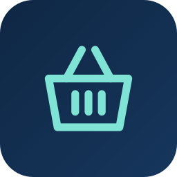

# Hi 👋, I'm Alessandro Cucchi

  

## 👨🏽‍🔬 Data Analyst for hire!

I'm a data analyst. I take raw numbers, work out what they really say, and explain them in plain language, helping turn data into insights that people can actually use.

- I'm drawn to questions where data can make a real difference
- I like digging into the details, finding patterns, and understanding what's behind the numbers
- I turn complex findings into clear, meaningful insights that are easy to communicate and act on
- Italian 🇮🇹 and English 🇬🇧

## 🚀 Featured project

<table>
  <tr>
    <td width="42%" align="center">
      
    </td>
    <td>
      <h3>Restaurant Demand Forecasting: how many covers tomorrow?</h3>
      
<b>The question:</b> can 829 restaurants forecast tomorrow's covers better than "same as last week", using their own history and online reservations?

      
<b>What the analysis found:</b>

      <ul>
        <li>Daily demand is volatile: in <b>63%</b> of restaurants covers move by more than half of an average day, and Saturday brings <b>1.6x</b> Monday's covers</li>
        <li>Online reservations show only part of the demand: <b>~21%</b> of covers where they are used, <b>17%</b> known the day before</li>
        <li>A gradient boosting model cuts the forecast error from <b>41.9% to 31.8%</b>: <b>24% fewer covers misplanned</b> and <b>45% less food prepared and not served</b></li>
        <li>The model under-forecasts by <b>~9%</b>: the bias is measured and flagged as the next fix, with holidays and one-off events still planned by hand</li>
      </ul>
      
      
      
      
        
      <a href="https://github.com/AlessandroCucchi/Restaurant_Demand_Forecasting"><b>Go to project →</b></a>
    </td>
  </tr>
</table>

<table>
  <tr>
    <td width="42%" align="center">
      
    </td>
    <td>
      <h3>Hotel Cancellation Analysis: which bookings will be cancelled, and what can a hotel do about it?</h3>
      
<b>The question:</b> for a resort and a city hotel, how often are bookings cancelled, when does it cost most, and can the risk be estimated on the day of booking?

      
<b>What the analysis found:</b>

      <ul>
        <li><b>37% of bookings are cancelled</b>, and cancellations peak when rooms are most expensive: resort prices rise <b>3.5x</b> in summer, and so do cancellations</li>
        <li>The risk grows with lead time: from <b>9.6%</b> for bookings made a week before arrival to <b>67.7%</b> for bookings made over a year ahead</li>
        <li>"Non Refund" bookings are cancelled <b>99.4%</b> of the time: they turned out to be tour-operator room blocks, a quarter of the city hotel's cancellations</li>
        <li>A model tested on 2017 bookings ranks cancellation risk with <b>ROC AUC 0.82</b>, after removing columns that leak the outcome, and feeds risk tiers and weekly forecasts. A <a href="https://public.tableau.com/views/HotelCancellationsRevenueatRisk/HotelCancellations">Tableau dashboard</a> summarises the KPIs</li>
      </ul>
      
      
      
      
      
        
      <a href="https://github.com/AlessandroCucchi/Hotel_Cancellation_Analysis"><b>Go to project →</b></a>
    </td>
  </tr>
</table>

<table>
  <tr>
    <td width="42%" align="center">
      
    </td>
    <td>
      <h3>Online Grocer Analysis: what keeps customers coming back every week?</h3>
      
<b>The question:</b> an online grocer delivering in fixed time slots lives on repeat business. When do customers order, how often do they come back, and what do they buy again?

      
<b>What the analysis found:</b>

      <ul>
        <li>Weekly shoppers are <b>32% of customers</b> but place <b>57% of all orders</b>; together with bi-weekly shoppers they place <b>81%</b></li>
        <li><b>30k regular customers (15%)</b> had a last gap of at least twice their usual rhythm, most of them bi-weekly shoppers</li>
        <li>Fresh food is <b>55% of the basket</b> and the most predictable demand: reordered <b>69% of the time</b> vs 55% for other products, which makes it the best place to cut waste with order data</li>
        <li>The first basket is an early signal: new customers who buy organic family items become weekly shoppers <b>40-44% of the time</b>, vs 32% overall</li>
      </ul>
      
      
      
      
      
        
      <a href="https://github.com/AlessandroCucchi/Online_Grocer_Analysis"><b>Go to project →</b></a>
    </td>
  </tr>
</table>

## More projects

- [Food Platform Analysis](https://github.com/AlessandroCucchi/Food_Platform_Analysis): customer growth and retention of a cooking platform
- [Wine Cultivar Analysis](https://github.com/AlessandroCucchi/Wine_Cultivar_Analysis): recognizing a wine's grape variety from its chemical profile
- [Fetal Health Classification](https://github.com/AlessandroCucchi/Fetal_Health_Classification): screening high-risk pregnancies from routine tests

      

## 🛠️ Tools

## 🤝 Let's connect

